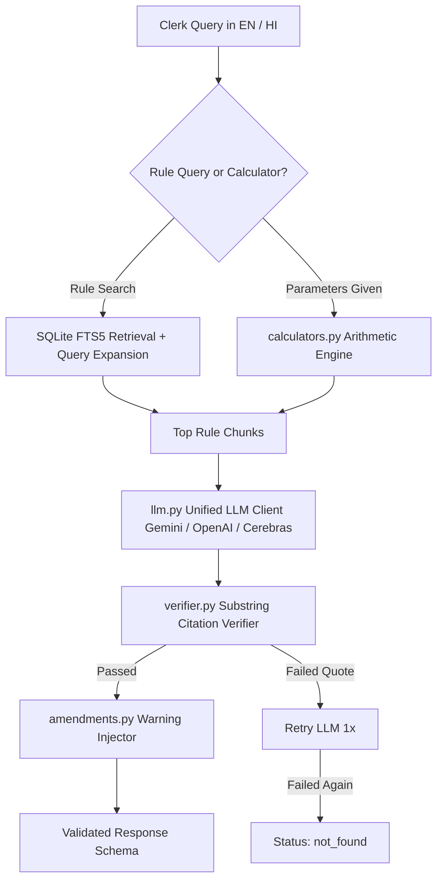

# Implementation Plan: Bhumi Vikas Sahayak (Backend)

## Objective
Build a robust, accurate, and typed backend for the Bhopal Municipal Corporation (BMC) building-permission clerk. The clerk can ask building rule questions in English or Hindi and receive a concise answer in the same language, accompanied by authoritative rule numbers, page numbers, and exact quotes from the MP Bhumi Vikas Rules 2012 (consolidated up to 6 March 2025).

---

## 1. Architectural Components

### Component Details
1. **Data Ingestion & Cleaning (`data_prep.py` / `db.py`)**
   - Read `data/bhumi_vikas_rules.jsonl` (106 rules).
   - Strip PDF running headers (e.g. `Rule 56   M.P. Bhumi Vikas Rules, 2012   78`).
   - Extract embedded rules into dedicated chunks:
     - Rule `12-A` from Rule `12` (Instant / Deemed approval up to 186 sq m)
     - Rule `17-a` from Rule `17` (Agricultural tourist facility)
     - Rule `25(A)` from Rule `25` (Appeal and revision)
     - Rule `26-A` from Rule `26` (Authorised Architect/Structural Engineer)
     - Rule `42-A` from Rule `42` (Norms for Information Technology)
     - Rule `93(a)` from Rule `93` (Dual water piping system)
   - Ingest into SQLite database (`data/bhumi_vikas.db`) with FTS5 virtual table for full-text search.

2. **Amendments Registry (`data/amendments.json` & `amendments.py`)**
   - Store amendment details for the 28 August 2026 notification regarding plots up to 500 sq m and Rule 2(5)(c).
   - Automatically inject the warning into `warnings[]` whenever a query touches Rule 2(5)(c) or plots up to 500 sq m.

3. **Arithmetic Engine (`calculators.py`)**
   - Hard Rule 1: No math in the LLM. All calculations performed purely in Python.
   - Setback & open space calculations (Rule 56, Table 8 and Table 9).
   - FAR, Ground Coverage, and Floor count calculations (Rule 56).
   - Building permission fee calculations (Rule 21 / 22 schedules).
   - Farmhouse plot size & FAR requirements (Rule 64).

4. **Unified LLM Module (`llm.py`)**
   - Single point of LLM integration.
   - Reads `PROVIDER`, `MODEL_FAST`, `MODEL_ANSWER` from environment variables.
   - Supports:
     - `gemini`: Native structured output via Gemini REST / SDK.
     - `openai` / `cerebras`: Native JSON schema / structured output via standard OpenAI compatibility.
     - `mock`: Fully offline deterministic fallback for test suites and environments without active API keys.

5. **Citation Verifier (`verifier.py`)**
   - Hard Rule 2: Substring verification with whitespace normalization (`re.sub(r'\s+', ' ', text).strip()`).
   - Verifies `{rule, page, quote}` against the retrieved rule chunk.
   - Retries once if the quote fails verification; if it fails again, safely sets status to `"not_found"`.

6. **FastAPI Application (`app.py`, `schemas.py`)**
   - Strict response format:
     - `status`: `"answered" | "not_found" | "needs_info"`
     - `answer`: concise answer in user's query language (English or Hindi)
     - `rule_no`: primary rule number (or multiple)
     - `citations`: list of `{rule, page, quote}`
     - `rules_version`: `"consolidated up to 2025-03-06"`
     - `warnings`: list of warnings (e.g. 28 Aug 2026 amendment)
     - `calculation`: optional calculation details
     - `disclaimer`: legal non-advice statement
   - Endpoints:
     - `POST /api/query`: Ask question
     - `POST /api/calculate`: Calculate setbacks/fees
     - `GET /api/rules/{rule_no}`: Inspect rule text
     - `GET /api/health`: Health status
   - Interactive UI for the clerk served at `/`.

7. **Verification & Testing (`tests/`)**
   - Test suite verifying:
     - Ingestion and chunk splitting.
     - Substring verifier and retry logic.
     - Calculator precision on official tables.
     - Response on all 17 sample questions (including unanswerable Q16/Q17 and amendment Q11).
   - License (`LICENSE`) & `.gitignore`.

---

## 2. Step-by-Step Execution Plan

- [ ] **Step 1**: Create `.gitignore`, `LICENSE` (MIT), and `data/amendments.json`.
- [ ] **Step 2**: Implement `data_prep.py` and `db.py` to clean running headers, split embedded rules, and build SQLite FTS5 database.
- [ ] **Step 3**: Implement `calculators.py` with setbacks, FAR, and fees according to Rules 21, 56, 64.
- [ ] **Step 4**: Implement `verifier.py` with normalized substring verification and retry logic.
- [ ] **Step 5**: Implement `llm.py` with Gemini, OpenAI/Cerebras, and mock provider support with Pydantic structured output.
- [ ] **Step 6**: Implement `service.py`, `schemas.py`, and `app.py` FastAPI server.
- [ ] **Step 7**: Implement frontend UI for BMC building permission clerk.
- [ ] **Step 8**: Implement comprehensive pytest test suite (`tests/test_prep.py`, `tests/test_calculators.py`, `tests/test_verifier.py`, `tests/test_api.py`) and evaluate all 17 questions.
- [ ] **Step 9**: Document run instructions in `README.md` and present results.
